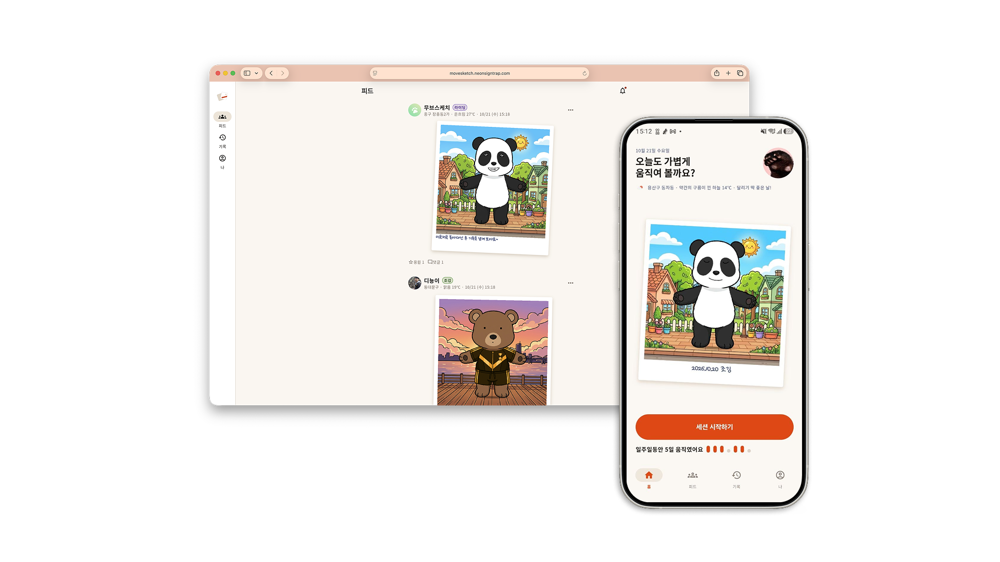
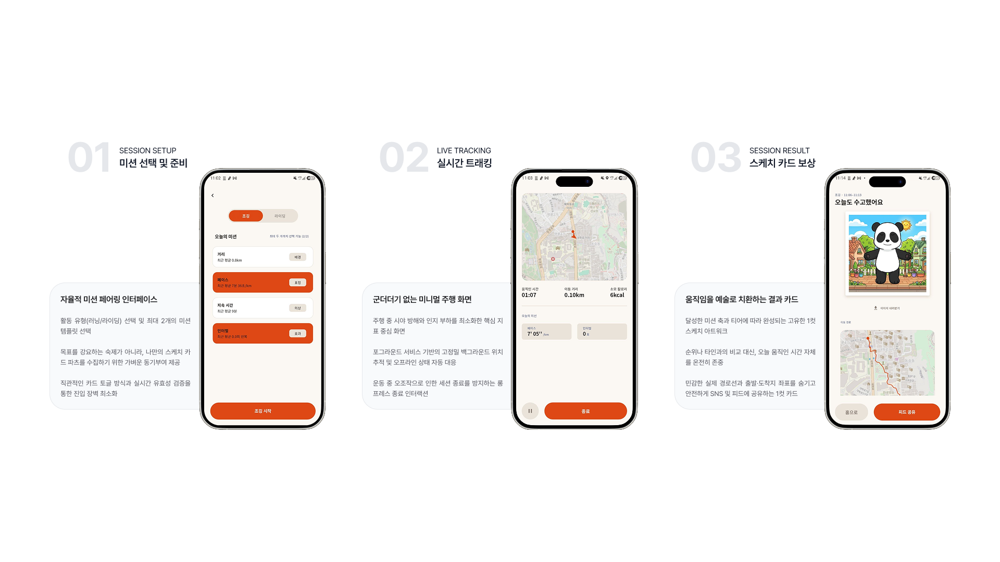

# MoveSketch

캐주얼하게 조깅과 라이딩을 즐기는 사용자를 위한 비경쟁형 운동 세션 트래킹 및 일러스트 아카이빙 앱입니다.  
경쟁과 수치 비교 위주의 기존 러닝 앱과 달리, 완결된 운동 결과를 데이터 기반의 스케치 이미지로 변환하여 기록합니다.

- **iOS**: [App Store](https://apps.apple.com/kr/app/id6819965333)
- **Android**: [Google Play](https://play.google.com/store/apps/details?id=com.neonsigntrap.move_sketch)
- **Web**: [웹 서비스 바로가기](https://movesketch.neonsigntrap.com)



---

## 1. 프로젝트 목적 및 핵심 철학

기존 피트니스 플랫폼은 리더보드와 페이스 단축 등 경쟁 요소에 집중되어 있어 일상적인 운동을 즐기는 사용자에게 심리적 피로를 유발합니다.  
반면 단순 만보기 앱은 이동 경로와 완결된 세션을 기록하지 못합니다.  
MoveSketch는 이 사이에서 다음과 같은 네 가지 원칙을 바탕으로 설계되었습니다.

- **비교 배제**: 랭킹 및 순위 비교 시스템이 없으며, 소셜 피드는 순수한 응원과 댓글 인터랙션만 제공합니다.
- **자율적 제안**: 운동 전 최대 2개의 미션 축(거리, 지속시간, 속도, 인터벌 등)을 선택하며, 미달성을 지적하지 않습니다.
- **실패 없는 기록**: 미션을 달성하지 못해도 세션은 온전히 보존되며 결과 화면에서 부족한 수치를 강조하지 않습니다.
- **프라이버시 분리 보호**: 개인 세션의 상세 이동 경로는 본인 계정의 비공개 기록으로 안전하게 보관되지만, 친구 및 타인에게 공개되는 소셜 피드에는 상세 GPS 좌표를 일절 공유하지 않고 동네 단위 지역명과 합성된 일러스트만 공유합니다.

---

## 2. 화면 및 주요 흐름



- **홈 (모바일)**: 오늘 날씨 요약, 미션 2개 축 선택, 세션 시작, 미동기화 세션 알림 배너
- **세션 트래킹 (모바일)**: OpenStreetMap 기반 실시간 경로 표시, 속도 임계값 기반 자동 일시정지, 현재 성과 실시간 집계
- **결과 및 아카이빙 (모바일)**: 달성 데이터 기반 오프스크린 Canvas 자동 합성, 로컬 갤러리 저장 및 피드 공유
- **피드 (모바일 / 웹)**: 친구들의 스케치 카드 목록, 응원 및 댓글 교류
- **기록 및 프로필 (모바일 / 웹)**: 월별 세션 기록 목록, 상세 경로 타임라인, 내 프로필 및 환경설정
- **관리자 콘솔 (웹)**: 공지사항 배포, 강제 업데이트 버전 정책, 커뮤니티 건전성을 위한 유저 신고 모니터링

---

## 3. 소프트웨어 아키텍처

MoveSketch는 [Flutter 공식 앱 아키텍처](https://docs.flutter.dev/app-architecture) 가이드라인을 준수하여 계층 간 관심사를 분리하고 단방향 데이터 흐름을 유지합니다.

```
lib/
├── config/                # 환경 변수, 전역 에셋 상수, 의존성 바인딩
├── data/                  # 데이터 소스 및 Repository 구현체
│   ├── repositories/      # Domain Repository 인터페이스 구체 구현
│   └── services/          # 물리적 I/O (Drift SQLite, Firestore, 위치/센서)
├── domain/                # 순수 비즈니스 로직 (외부 의존성 없음)
│   ├── models/            # 불변 데이터 모델, Record, Sealed Class
│   └── use_cases/         # 단일 책임을 갖는 유스케이스
├── routing/               # GoRouter 기반 선언형 네비게이션
├── ui/                    # Feature-first 기반 MVVM 프레젠테이션 계층
│   ├── core/              # 테마 및 공유 컴포넌트
│   └── <feature>/         # 기능별 화면 모듈 (home, session, feed, history, admin 등)
│       ├── view_models/   # Riverpod 상태 관리 (Notifier / AsyncNotifier)
│       └── widgets/       # 화면 및 종속적 UI 컴포넌트
└── utils/                 # Result 패턴, 좌표 연산 유틸리티
```

- **도메인 계층의 독립성**: 비즈니스 규칙(미션 달성 티어 판정, 스케치 파츠 슬롯 결정, 동기화 정책)은 Flutter 프레임워크에 의존하지 않는 순수 Dart 클래스로 작성되어 단위 테스트와 유지보수가 용이합니다.
- **불변 모델과 Result 패턴**: 모든 도메인 모델은 `final` 불변 필드로 구성되며, 데이터 처리 결과는 `Result<T>`를 반환하여 UI 계층에서 Dart 3 `switch` 패턴 매칭으로 성공과 실패를 명시적으로 처리합니다.

---

## 4. 핵심 엔지니어링 구현 상세

### 4.1 저수준 Canvas 기반 오프스크린 이미지 합성 (`SketchImageRenderer`)
- **문제**: 화면에 보이는 위젯을 캡처하는 방식은 렌더링 프레임 대기 시간이 필요하여 비동기 타이밍 문제가 발생할 수 있고, 기기 해상도에 따라 출력 결과물의 품질이 달라집니다.
- **해결**:
    - `dart:ui.PictureRecorder`와 `dart:ui.Canvas`를 활용해 화면 위젯 트리와 분리된 독립 렌더러를 구축했습니다.
    - 백그라운드에서 직접 이미지 에셋 바이트를 읽어 512×512 크기의 무손실 PNG를 직접 조립합니다.
    - `saveLayer`와 `BlendMode.color`, `BlendMode.dstIn` 레이어 마스킹을 적용해 원본 일러스트의 음영을 유지하면서 의상 색상(Tint)을 자연스럽게 변환합니다.

### 4.2 오프라인 우선(Local-first) 저장 및 안전한 동기화
- **문제**: 터널 통과, 외곽 지역 이동, 배터리 부족 등으로 네트워크가 차단된 상태에서 운동이 종료될 경우 데이터 유실 위험이 있습니다.
- **해결**:
    - 모든 세션 데이터와 위치 정보는 Drift(SQLite)를 통해 로컬 트랜잭션에 우선 저장됩니다.
    - `SyncPendingSessionsUseCase`가 네트워크 연결 복구와 앱 실행 시점을 감지하여, 대기 중인 세션을 Firestore로 안전하게 동기화합니다. 네트워크 재시도가 발생하더라도 데이터가 중복 생성되지 않도록 처리했습니다.
    - 미동기화 세션이 남아 있을 경우 홈 화면 상단에 배너를 표시하여 사용자가 동기화 상태를 직접 인지하고 수동으로 재시도할 수 있도록 지원합니다.

### 4.3 위치 노이즈 필터링 및 자동 일시정지 (Auto Pause)
- **문제**: 신호 대기나 휴식 중 발생하는 GPS 수신 오차로 인해 정지 상태임에도 이동 거리가 계속 늘어나는 문제가 있습니다.
- **해결**:
    - `Geolocator` 위치 스트림에 수신 정확도 및 속도 임계값 필터를 적용했습니다.
    - 사용자의 이동 속도가 기준치 이하로 떨어지면 타이머와 거리 측정을 일시정지하고, 이동이 재개되면 측정을 복구하여 실제 운동 시간과 평균 속도의 신뢰도를 확보했습니다.

### 4.4 프라이버시 중심의 데이터 분리
- **문제**: 상세 GPS 경로를 소셜 피드에 그대로 공개하면 사용자의 거주지나 생활 반경이 노출될 수 있습니다.
- **해결**:
    - 고정밀 GPS 폴리라인 데이터는 본인만 조회할 수 있는 비공개 세션 기록에만 보관됩니다.
    - 타인과 소통하는 소셜 피드에는 역지오코딩(Reverse Geocoding)으로 변환된 동 단위 지역명과 생성된 스케치 일러스트만 전송하여 사용자의 개인 동선을 보호합니다.

---

## 5. 주요 기술 스택

| 영역 | 도입 기술 | 채택 배경 |
| :--- | :--- | :--- |
| **Framework** | Flutter 3.44.4 (Dart 3.12.2) | 모바일(iOS/Android)과 웹을 단일 코드베이스로 구현하여 개발 및 유지보수 효율 확보 |
| **State Management** | Riverpod 3.x | 컴파일 타임 의존성 검증, 안전한 상태 주입 및 반응형 캐싱 |
| **Local Storage** | Drift (SQLite) | 오프라인 우선 세션 보관, 타입 안전한 SQL 쿼리 및 트랜잭션 보장 |
| **Cloud Backend** | Firebase (Auth, Firestore, Storage) | 소셜 로그인, 원격 데이터베이스 및 이미지 저장소 |
| **Serverless** | Cloud Functions (Node.js 24) | FCM 푸시 알림 발송 및 일일 운동 리마인더 스케줄러 |
| **Map & Location** | flutter_map, geolocator | OpenStreetMap 기반 지도 렌더링 및 고정밀 위치 스트림 수집 |

---

## 6. 실행 및 빌드 가이드

### 6.1 사전 요구 사항
- [FVM (Flutter Version Management)](https://fvm.app/) (지정 Flutter 버전: `3.44.4`)
- Dart SDK `^3.12.2`

### 6.2 설정 및 실행 단계
1. 의존성 설치 및 코드 생성:
   ```bash
   fvm flutter pub get
   fvm dart run build_runner build
   ```

2. 환경 변수 파일 설정:
   프로젝트 루트 경로에 `env.json` 파일을 생성하고 날씨 API 키를 입력합니다:
   ```json
   {
     "OPENWEATHER_API_KEY": "YOUR_OPENWEATHER_API_KEY"
   }
   ```

3. 실행:
   ```bash
   # 모바일 앱 실행
   fvm flutter run --dart-define-from-file=env.json

   # 웹 환경 실행 (피드, 기록, 관리자 기능)
   fvm flutter run -d chrome --dart-define-from-file=env.json
   ```
